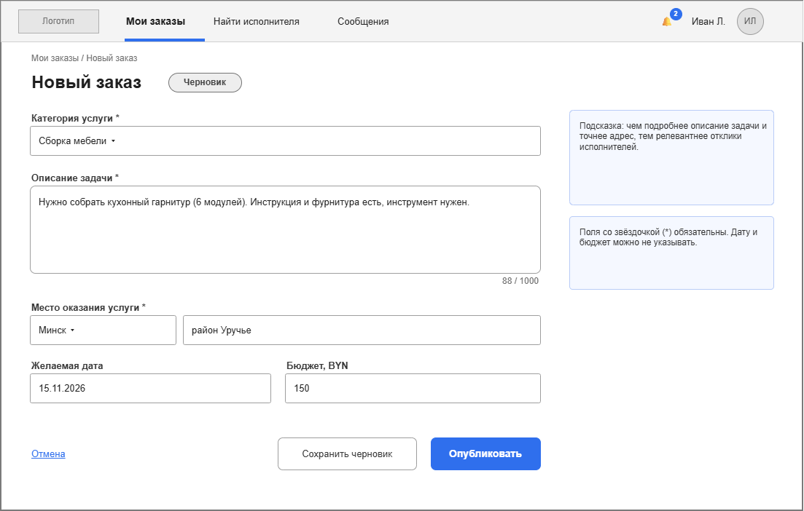
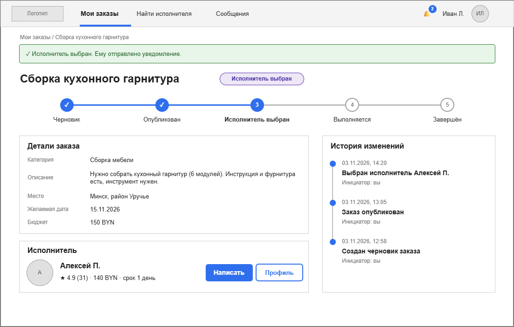

# 5 Руководство пользователя

Руководство описывает проектируемые сценарии. Иллюстрации взяты из исходных прототипов ЛР 3; ниже указаны дополнения итерации. Работающий сервис в рамках лабораторной не развёртывается.

## Создание и публикация заказа

Заказчик открывает «Мои заказы» и выбирает создание. Заполняет категорию, описание и место; дату и бюджет указывает при необходимости. «Сохранить черновик» откладывает публикацию, «Опубликовать» проверяет обязательные поля. При ошибке данные сохраняются, сообщения указывают требующие исправления поля. После публикации заказ доступен исполнителям; рассылка выполняется отдельно.

Исходный экран создания заказа из ЛР 3

## Выбор исполнителя и подтверждение работ

Заказчик сравнивает отклики по стоимости, сроку, профилю, рейтингу и отзывам. После нажатия «Выбрать» проверяет сведения в подтверждении. Выбранный исполнитель закрепляется за заказом, остальные отклики отклоняются. Исполнитель начинает работы, затем сообщает о выполнении. В новой редакции заказ переходит в «Ожидает подтверждения». Заказчик проверяет результат и подтверждает завершение; после этого доступен отзыв.

Исходный экран после выбора исполнителя из ЛР 3

## Отмена и состояние оплаты

До выбора исполнителя заказчик может отменить заказ: подтвердить действие и указать причину. В блоке оплаты pending означает уточнение результата. Повтор проверки или прежнего запроса не создаёт новую оплату. После подтверждённого отказа или отмены платежа доступна новая попытка; после успеха — только просмотр результата. Учебный макет этих дополнений доступен в prototypes/index.html.
